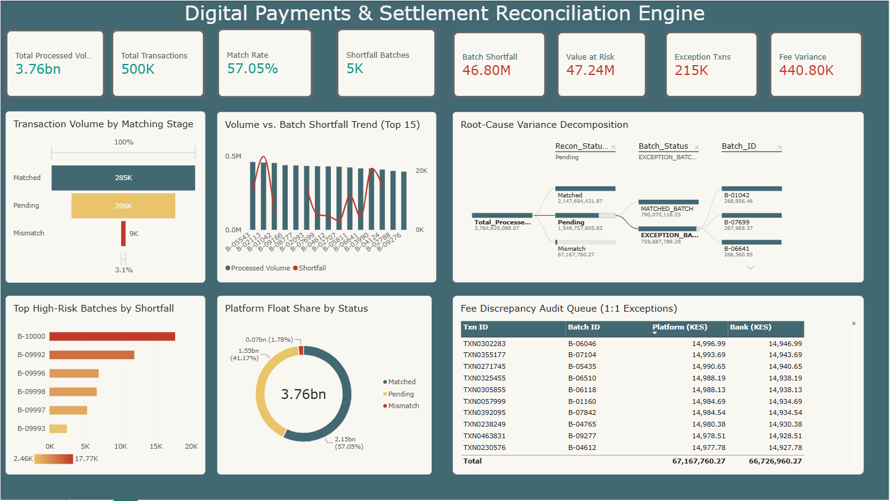

# Digital Payments & Settlement Reconciliation Engine

### 📊 Executive Summary
In high-volume digital payments and fintech environments, unresolved float variances and settlement drop-offs between internal platforms and banking gateways represent massive financial risk. 

This project is an end-to-end **Settlement & Reconciliation Analytics Engine** built to ingest, model, and audit 500,000 daily payment transactions. Designed for Fraud, Risk, and Operations teams, the dashboard automatically isolates 1:1 transaction mismatches, tracks batch-level shortfalls, and provides an actionable audit queue to recover at-risk capital.

### 🎯 Key Business Impact
* **Automated Exception Detection:** Instantly isolates **215K exception transactions** out of 500K total volume, bypassing manual Excel reconciliations.
* **Financial Risk Exposure Tracking:** Pinpoints **46.80M in batch shortfalls** and **47.24M in total value at risk**, prioritizing high-dollar variances.
* **Root-Cause Diagnostics:** Empowers operations teams to trace a **440.80K fee variance** directly down to the specific batch and transaction ID for immediate bank escalation.

### 🛠️ Technical Architecture
* **Data Generation (Python):** Engineered a synthetic data pipeline using `Pandas` and `Faker` to simulate 500,000 realistic digital payment transactions, incorporating natural distribution curves for matched settlements, gateway timeouts, and API fee discrepancies.
* **Data Modeling (Power BI):** Developed a robust Star Schema consisting of `Fact_Phase1_Transactions`, `Fact_Phase2_Batches`, and a custom `Dim_Date` table.
* **Analytics & DAX:** Authored complex DAX measures to calculate dynamic match rates, line-item fee variances, and conditional aggregations for pipeline funneling.
* **UI/UX Design:** Designed a dark-navy enterprise interface featuring semantic risk coloring (Crimson for exceptions, Teal for matches) to reduce cognitive load for senior leadership.

### 📈 Dashboard Features & Deep-Dive Analytics
1. **Transaction Volume Funnel:** Visualizes the pipeline flow from 500K total transactions down to matched (285K), pending (206K), and mismatched (9K) stages.
2. **Volume vs. Batch Shortfall Trend (Top 15):** A dual-axis line and clustered column chart correlating massive processing volumes against gateway shortfall risk, proving that failure rates scale non-linearly with batch size.
3. **Root-Cause Variance Decomposition:** An interactive AI decomposition tree that allows finance leaders to dynamically drill down from the 3.76bn total processed volume, through pending statuses, directly into the specific batch IDs causing the 759M exception shortfall.
4. **Top High-Risk Batches (Pareto Analysis):** A conditionally formatted gradient bar chart instantly flagging the heaviest financial bleed (e.g., Batch B-10000).
5. **Actionable Fee Discrepancy Queue:** A visually filtered, granular ledger exposing 1:1 exceptions. Displays the exact Platform (KES) vs. Bank (KES) monetary mismatch per Txn ID, ready to be exported by the dispute resolution team.

### 💼 Strategic Recommendations
* **Automate Gateway Timeout Alerts:** The high volume of pending statuses (206K) indicates severe API timeout issues with banking partners; implement automated alerts when batch completion times exceed SLA thresholds.
* **Prioritize High-Volume Batch Audits:** The Volume vs. Shortfall trend reveals that the largest processing batches do not always carry the highest shortfall risk; operations should prioritize audits based on the `Batch_Shortfall` measure rather than raw transaction volume.
* **Renegotiate API Fee Structures:** The 440.80K fee variance points to misaligned deduction logic between the internal platform and the banking gateway; recommend a joint technical audit with the gateway provider to align float deduction calculations.

### 🚀 How to Navigate This Repository
* `main.py` & `reconciliation_engine.py`: The core Python scripts used to generate the synthetic Phase 1 (Transactions) and Phase 2 (Batches) datasets.
* `Settlement Recon Engine.pbix`: The interactive Power BI dashboard file.
* `settlements_dashboard.png`: High-resolution screenshot of the dashboard interface.

***

**Author:** Hilda Kiptoo  
**Role Target:** Senior Data Analyst | Fraud & Risk Analytics Lead  
**Stack:** Python, Power BI, DAX, SQL, Star Schema Data Modeling